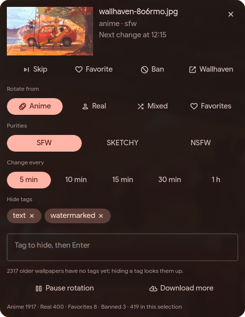
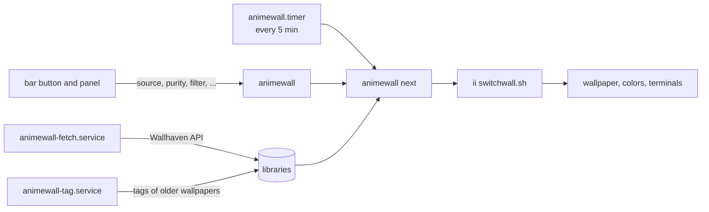

<div align="center">

# animewall

**Wallhaven wallpapers for end-4's illogical-impulse, switched on a timer and run from a panel in the bar.**

[](LICENSE)
[](https://github.com/end-4/dots-hyprland)




</div>

animewall keeps wallpaper libraries filled from [Wallhaven](https://wallhaven.cc) and changes your wallpaper every few minutes. It changes it through illogical-impulse's own `switchwall.sh`, so the colors of the bar, the shell and the terminals follow every wallpaper, just like picking one by hand.

## What it does

- **Libraries from Wallhaven.** An anime library and a non-anime one, with one folder per purity, at 2560x1440 or more in 16:10 and 16:9 by default. Each library is capped by image count and by size.
- **Rotation without repeats.** Each library is shuffled like a deck, so nothing comes back until everything has shown. Change every 5, 10, 15, 30 or 60 minutes, or pause.
- **A panel in the bar.** Skip, favorite, ban or open the wallpaper on Wallhaven, and pick what rotates: Anime, Real, Mixed or Favorites, in any mix of SFW, sketchy and NSFW.
- **A bar button.** Click it for the panel, right click for the next wallpaper, middle click to favorite the one on screen.
- **Downloads that follow the panel.** Download more fetches exactly what is selected. Pick a selection with nothing in it yet, and it downloads some and switches as soon as the first one lands.
- **Hidden tags.** Hide a tag in the panel and wallpapers carrying it leave the rotation and are skipped by downloads. Older wallpapers get their tags looked up in the background.
- **Favorites and bans.** Favorites are kept as copies in a library of their own. A ban moves the files aside and keeps the wallpaper from being downloaded again.
- **A fix for ii's terminal colors.** illogical-impulse's color template leaves every open terminal stuck inside an unclosed escape code after a wallpaper change. TUIs like Claude Code or codex then stop drawing until something breaks them out. animewall patches the template.

## Requirements

- Hyprland with [illogical-impulse](https://github.com/end-4/dots-hyprland), the `ii` Quickshell config
- Python 3.11 or newer
- a systemd user session, `notify-send`, `xdg-open` and GNU `patch`
- for NSFW only: a Wallhaven API key, with NSFW turned on in your Wallhaven browsing settings

## Install

```sh
git clone https://github.com/ellentane/animewall ~/Projects/animewall
cd ~/Projects/animewall
./install.sh
```

`install.sh` links the CLI, the systemd units and the panel files from the clone into place, so a `git pull` is live at once. It applies the patches to illogical-impulse that are not in yet and starts the timer on the first install. If a different file is already where a link goes, it is kept beside it as `*.before-install`. An ii update overwrites the patched files, so run it again after one.

Then click the photo icon just left of the tray and press **Download more**. The first wallpaper shows up as soon as it is downloaded.

The patches are made against dots-hyprland [`6eb590b1`](https://github.com/end-4/dots-hyprland/commit/6eb590b1a2f3948b1700a3b3a626a13eb2526665). If your ii has moved too far from it, `install.sh` names the patch that no longer applies.

## Use

The panel does everything day to day. The same is there from a terminal:

| Command | What it does |
| --- | --- |
| `animewall` | show the state: current wallpaper, selection, timer, downloads, libraries |
| `animewall next` | switch to the next wallpaper |
| `animewall source anime\|real\|mixed\|favorites` | choose which library rotates |
| `animewall purity sfw\|sketchy\|nsfw ...` | choose which purities rotate (`all` for every one) |
| `animewall favorite` | add the current wallpaper to favorites, or take it out |
| `animewall ban` | take the current wallpaper out for good (moved, not deleted) |
| `animewall filter hide\|unhide TAG ...` | hide wallpapers with any of these tags, or show them again |
| `animewall filter [clear]` | list the hidden tags, or hide nothing |
| `animewall open` | open the current wallpaper's Wallhaven page |
| `animewall interval 5\|10\|15\|30\|60` | minutes between changes |
| `animewall pause` / `resume` | stop or restart the rotation |
| `animewall download start\|stop\|run` | the background download, or one in the foreground |
| `animewall status --json` | the state as JSON, which the panel reads |

The panel also answers over IPC (`qs -c ii ipc call animewall toggle`, with `close`, `next`, `favorite` and `ban`), and registers the global shortcut `quickshell:animewallToggle` for a keybind of your own:

```lua
-- hyprland.lua (Hyprland 0.57 and newer)
hl.bind("SUPER + W", hl.dsp.global("quickshell:animewallToggle"), { description = "Wallpaper panel" })
```

```ini
# hyprland.conf (older Hyprland)
bind = SUPER, W, global, quickshell:animewallToggle
```

## Configuration

`~/.config/animewall/config.toml` is written with the defaults on first run. `WALLHAVEN_API_KEY` in the environment works too.

| Key | Default | Meaning |
| --- | --- | --- |
| `api_key` | `""` | Wallhaven API key, needed for NSFW |
| `library` | `~/Pictures/Wallpapers/anime` | the anime library |
| `min_resolution` | `2560x1440` | smallest size downloaded |
| `ratios` | `16x10,16x9` | aspect ratios downloaded |
| `max_images` / `max_gb` | `1500` / `20` | each purity folder stops at `max_images`, the whole library at `max_gb` |
| `sortings` | `favorites, toplist, views` | Wallhaven sort orders walked in turn |
| `other_library` | `~/Pictures/Wallpapers/other` | the non-anime library ("Real" in the panel) |
| `other_categories` | `101` | Wallhaven categories for it: general and people |
| `other_max_images` / `other_max_gb` | `400` / `6` | its caps |
| `other_queries` | `[]` | search terms for it, each searched in turn; empty searches everything |
| `other_exclude` | `""` | exclusions added to each of its searches, like `"-tag -other"` |
| `mixed_real_share` | `20` | percent of Mixed changes that come from the non-anime library |
| `favorites_library` | `~/Pictures/Wallpapers/favorites` | where favorites are copied |

The selection, the shuffled decks, hidden tags, recorded tags and banned files live in `~/.local/state/animewall`.

## How it fits together



## Uninstall

```sh
systemctl --user disable --now animewall.timer
rm ~/.local/bin/animewall ~/.config/systemd/user/animewall*.service ~/.config/systemd/user/animewall.timer
rm -r ~/.config/quickshell/ii/modules/ii/animewall ~/.config/quickshell/ii/services/Animewall.qml
for p in patches/*.patch; do patch -d ~/.config/quickshell/ii -p1 -R < "$p"; done
```

The libraries, the config and the state stay until you delete them.

## Credits

Built on [end-4/dots-hyprland](https://github.com/end-4/dots-hyprland) and [Quickshell](https://quickshell.org). Wallpapers come from [Wallhaven](https://wallhaven.cc) through its public API; animewall is not affiliated with it.

## License

[GPL-3.0](LICENSE), the same as dots-hyprland, which the panel and the patches build on.
